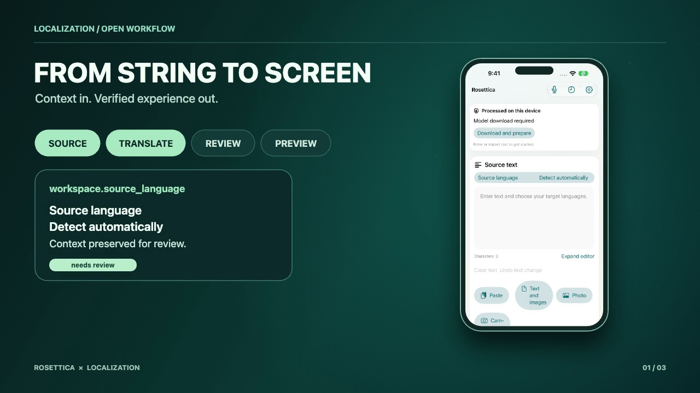
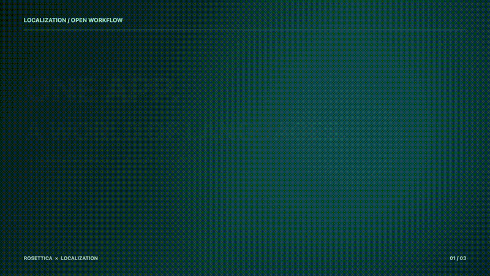
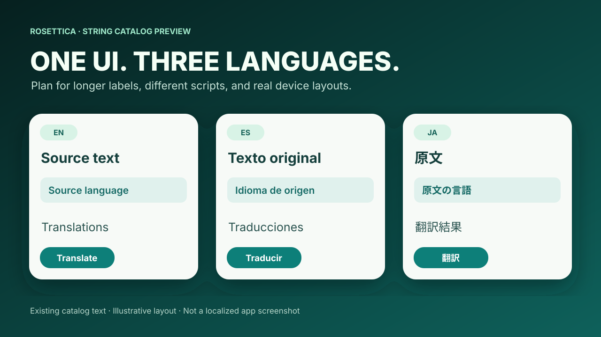

# Localize the experience. Keep control of the process.



[Watch the 8-second product story](media/localization-story.mp4) · [HTML animation source](media/animation.html)



**An incremental localization workflow for Apple apps.** Keep original copy, translator context, model provenance, review status, and String Catalog checks together. Start with [Apple's localization guidance](https://developer.apple.com/localization/) for platform setup; use this toolkit to make subsequent catalog updates traceable.

## See it in Rosettica

**Rosettica** is an [iPhone, iPad, and Mac translation app on the App Store](https://apps.apple.com/us/app/rosettica/id6759609293). Its workspace, language selection, and settings show why context matters when localizing an app. The video uses a real empty-state iPhone screenshot from its October 8, 2026 distribution asset set (app version 1.2.7), combined with original motion graphics. It contains no user documents or fabricated translation results.

This workflow translates the app's interface resources during development. Rosettica's on-device translation is a separate runtime feature.



The English, Spanish, and Japanese labels above come from existing Rosettica String Catalog values. The cards illustrate text length and script changes; they are design illustrations rather than localized app screenshots or evidence of human linguistic approval.

[Get Rosettica on the App Store](https://apps.apple.com/us/app/rosettica/id6759609293)

## Workflow

| Step | What the toolkit records or checks |
| --- | --- |
| Register | Stable key, original string, and translator context |
| Plan | Missing or source-changed key–locale pairs |
| Translate | English from a non-English original, then target locales from English, through a configured local TranslateGemma 27B service; project-authored English originals are retained |
| Export | Merge into `.xcstrings`, preserving unrelated entries and stopping on conflicting values or plural/substitution structures |
| Verify | Source fingerprint, model identity, placeholders, locale coverage, and review states |

This first version writes Xcode String Catalogs. Its source registry and review-state pattern can be adapted to other localization formats; other exporters are not included yet.

## Run the fictional example

Python 3.10+ on macOS is required. The CLI uses the standard library. The sample contains three fictional source strings and an empty catalog; no translations are fabricated for the demo.

```sh
python3 localize.py --config project.json plan
```

For your own app, copy `project.json` and the source registry, then set catalog paths and locale names. Keep the service address and credential in your local environment. `LOCALIZE_BASE_URL` must identify a localhost or private-network HTTP(S) service; `LOCALIZE_API_KEY` is optional if the service does not require authentication.

Use a separate configuration and cache for each catalog, including permission-purpose strings in `InfoPlist.xcstrings`.

```sh
python3 localize.py --config project.json translate --limit 10
python3 localize.py --config project.json export
python3 localize.py --config project.json verify
```

Add `--keys home.title import.action` to any command to limit it to those stable keys. Keep the same scope throughout an update. Source wording, context, and protected-term changes invalidate affected cached translations. A previously exported value can be updated when it still matches the recorded export; conflicting edits stop the merge.

The service adapter expects an OpenAI-compatible `/v1/completions` endpoint accepting the included app-localization prompt and returning the exact configured model identifier. This prompt adapter has not been verified against every TranslateGemma serving backend. Verify it with a small scoped run before using a production catalog. Accepted rows save incrementally in the ignored `work/` directory; failed rows remain pending.

For a quantized 27B deployment, configure `translategemma-27b-it-4bit` only if it is the exact identifier returned by your approved service. That identifier describes a 27B model in 4-bit form. The toolkit does not select a different model automatically.

## Use with an agent

The bundled [localize-apple-app skill](skills/localize-apple-app/SKILL.md) guides an agent through key scoping, local translation, catalog verification, and privacy review. Install the whole skill folder, including its `scripts/` directory, in your agent's skill directory, or ask an agent to read it in this repository. The standalone CLI travels with the skill; the root launcher uses that same implementation. It uses the target project's configuration and grants no permission to publish.

## Review states and limits

- New model-generated values export as `needs_review`. A person must accept the wording and check the app layout before marking them `translated`.
- Structural verification reports outstanding review counts; it does not certify language quality.
- Conflicting existing catalog values stop export for explicit resolution. No existing value is silently replaced.
- Plural and substitution entries require a scoped variant plan and are not generated by this first version.
- Check text expansion, right-to-left layout, dates and numbers, Dynamic Type, and device sizes in the app. Apple recommends native-speaker feedback when machine translation is used. [Apple localization guidance](https://developer.apple.com/localization/).

## Privacy and release

This folder contains fictional source strings, reusable code, and reviewed showcase assets. Rosettica's production catalog, translation cache, user documents, credentials, model weights, and private service settings are excluded. Run `python3 scripts/check_release.py` before preparing a public copy. It checks an explicit [release file list](release-files.json), common secret and path patterns, and hashes of reviewed media. Inspect image pixels and the final repository history as well. Automated scanning cannot establish that arbitrary new content is safe.

This is an **initial source release**. Read [the review record](RELEASE_REVIEW.md) for verification and remaining limits. The real-service translation adapter has not been validated against a live 27B endpoint in this release; verify a small scoped run before using a production catalog. Current multilingual app captures remain future work.

## Licensing

The original toolkit code and motion graphics are offered under [Apache License 2.0](LICENSE). Rosettica's name, app interface, and screenshots remain the app owner's property and are included as a showcase; the software license does not grant app branding rights. TranslateGemma model weights are governed separately by Google's [Gemma Terms of Use](https://ai.google.dev/gemma/terms). No model weights are distributed here. The [TranslateGemma 27B model card](https://huggingface.co/google/translategemma-27b-it) identifies its model license as Gemma.

This is an independent community project. Apple and Google have not endorsed it.
